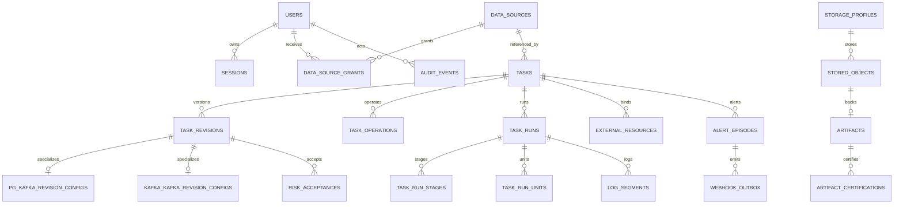

> 历史架构设计：包含首期约束和后续已调整的行为，当前支持范围以 README、路线图和操作文档为准。

# ape-dts 管理平台核心数据模型

> 状态：首期实施基线
> 日期：2026-09-01
> 数据库：外部 PostgreSQL，固定业务 Schema `ape_dts_platform`

## 1. 建模原则

1. PostgreSQL 是持久元数据唯一事实来源；数据库记录和容器内实际进程必须通过显式 reconciliation 对账。
2. 核心业务身份、状态、所有权和删除边界使用类型化列，不把无法约束的 JSONB 当主模型。
3. JSONB 仅保存带 `schema_version` 的任务类型配置快照、探针原始结果和外部元数据快照；进入领域层前必须按对应版本校验。
4. 主键使用 UUID；时间统一 `timestamptz`；字节数和 Offset/LSN 计数使用 `bigint` 或原生 PG 类型，不使用 JS 浮点数持久化。
5. 可编辑实体含 `row_version bigint`，所有更新同时匹配 `id + row_version + deleted_at IS NULL`。
6. 默认外键 `ON DELETE RESTRICT`。只允许运行域的从属表随已确认到期的 run 删除；任务、修订、数据源、审计、告警、指标和外部资源不能被数据库级联误删。
7. 所有 Secret 密文与所有者、用途、AAD 版本绑定；软删除 Secret 所有者时执行密码学销毁，而不是保留可恢复密文。
8. 显示状态可以派生，数据库只保存正交事实；例如告警 ACK、任务监控降级不覆盖异常/运行状态。

## 2. 关系总览



图中未展开 Metrics 分区、恢复阶段、加密包装和日志缺口表，详见下文。

## 3. Schema、实例和全局配置

### 3.1 `schema_migrations`

| 列 | 说明 |
| --- | --- |
| `version` | 递增迁移版本，主键 |
| `checksum` | 仓库 SQL 文件 SHA-256 |
| `platform_version` | 首次包含该迁移的平台版本 |
| `applied_at` | 事务提交时间 |
| `applied_by_instance_id` | 执行容器实例 |

迁移前必须验证全部已应用 checksum；不一致视为 Schema 异常，不能补表。

### 3.2 `platform_instances`

记录每次容器进程：`id`、平台版本、启动时间、最后心跳、结束时间、结束原因、是否干净停止、当前恢复会话。PID 只作诊断字段，不能跨容器当身份。

### 3.3 `platform_settings`

固定单行，不使用任意 key/value：

| 配置 | 初始值/规则 |
| --- | --- |
| `max_runtime_units` | 初始为 NULL；首次启动任务前由管理员显式设置正整数 |
| `log_retention_days` | 30，正整数 |
| `run_log_limit_bytes` | 1 GiB，正且有限 |
| `log_failure_buffer_bytes` | 64 MiB，正且有限 |
| `run_retention_days` | 365，正整数 |
| `alert_retention_days` | 365，正整数；从 episode 最后变为 RESOLVED 起算 |
| `audit_retention_days` | 至少 180；不能配置得更短 |
| `metrics_capacity_alert_bytes` | NULL 表示未配置，不触发阈值告警 |
| 资源阈值/持续时间 | 每项均可 NULL；只有阈值和持续时间同时存在才启用 |

设置表含 `row_version`、修改人和修改时间。会追溯删除历史数据或丢弃内存缓冲的设置变更必须先建立影响预览 token；保存时校验 token、设置版本和影响集合摘要仍一致。

### 3.4 `recovery_sessions` / `recovery_steps`

一次容器恢复一个 session。step 使用固定类型：`LOAD_METADATA`、`UNLOCK_KEYS`、`ENSURE_ARTIFACTS`、`VERIFY_CONTINUITY`、`PLAN_CAPACITY`、`RESTORE_BATCHES`、`READY_OBSERVABILITY`。记录状态、进度事实、失败码、错误摘要、尝试次数和人工动作，不保存 Secret。

## 4. 密钥、用户与 Session

### 4.1 `key_wrappers`

| 列 | 说明 |
| --- | --- |
| `wrapper_type` | `PASSPHRASE | RECOVERY` |
| `version` | 递增版本 |
| `kdf_algorithm/parameters/salt` | Argon2id 等算法与参数；每个平台独立盐 |
| `ciphertext/nonce/tag` | 同一 DEK 的认证加密包装 |
| `active` | 每种类型只能一个活动版本 |

离线恢复密钥本身绝不入库。口令/恢复密钥变更事务只新增对应 wrapper、切换 active 并停用旧 wrapper；`secrets.ciphertext` 必须逐字节不变。

### 4.2 `secrets`

`owner_type`、`owner_id`、`purpose`、算法、DEK 版本、AAD 版本、nonce、ciphertext、tag、创建/销毁时间。活动唯一约束为 `owner_type + owner_id + purpose WHERE destroyed_at IS NULL`。

AAD 规范化包含：平台 Schema、owner type、owner UUID、purpose、secret row UUID、AAD version。解密前重新构造并验证；密文不能换到另一数据源或用途。

### 4.3 `users`

关键列：规范化用户名、展示名、`role=ADMIN|DEVELOPER`、`status=INVITED|PASSWORD_REQUIRED|TOTP_REQUIRED|ACTIVE|DISABLED`、Argon2id 密码哈希和参数、TOTP secret 引用、`session_generation`、`row_version`。

- 用户不物理删除，只能 DISABLED，以保留审计主体。
- 管理员创建用户后生成一次性激活码，只保存哈希和过期时间；管理员页面只展示一次。用户用用户名+激活码设置自己的密码。
- 角色改为 ADMIN 后必须进入 TOTP_REQUIRED，验证前不能管理平台。
- 密码、角色、TOTP 或启停变化时递增 `session_generation`，现有 Session 立即失效。
- 禁止停用或降级最后一个 ACTIVE 管理员；事务内锁定管理员集合再次计数。

### 4.4 `totp_recovery_codes`、`sessions`、`auth_attempt_buckets`

- 恢复码：用户、独立随机盐哈希、创建/使用时间；`used_at IS NULL` 才能原子消费。
- Session：只保存高熵 token 哈希、用户、创建/最后活动、空闲/绝对到期、Session generation、撤销时间和原因。
- 认证限速桶：账号键、来源键、场景（密码/TOTP/恢复码/Bootstrap）、窗口和失败计数；成功不会删除审计事实。

## 5. 存储与制品

### 5.1 `storage_profiles`

`driver=LOCAL|OSS`、非 Secret 配置 JSON、Secret 引用、`state=DRAFT|ACTIVE_WRITE|READ_ONLY_REFERENCED|RETIRED`、最近测试结果和 row version。部分唯一索引保证仅一个 ACTIVE_WRITE。

LOCAL 配置不允许改变固定根 `/data/storage`；数据库只保存根下规范化相对前缀。OSS 配置保存 endpoint/bucket/prefix 等非 Secret，访问密钥进入 `secrets`。

### 5.2 `stored_objects`

每个文件对象记录：`storage_profile_id`、`kind=ARTIFACT|LOG_SEGMENT`、随机内部 object key、大小、SHA-256、内容类型、`state=PENDING|AVAILABLE|DELETED|MISSING|INTEGRITY_FAILED`、创建/删除时间。

- object key 由平台生成或在制品登记时经过严格规范化，不能直接作为本地缓存文件名。
- 读取/下载前核对 profile、大小和 SHA-256；不匹配时不返回内容。
- `storage_profile_id` 不随当前写 profile 变化。
- `created_by_actor_type=USER|SYSTEM` 明确记录来源：`USER` 必须携带 `created_by_user_id`，`SYSTEM` 必须为 NULL。兼容旧写入时缺省来源只表示 `USER`，系统路径必须显式写 `SYSTEM`，不能借用管理员用户。
- profile 只有在不存在任何 `state != DELETED` 的 object 引用，且未被 `STARTING|RUNNING|STOPPING` 的 run 绑定时，才能 RETIRED 并销毁 Secret。

### 5.3 `artifacts`

关键列：唯一版本标识、声明来源、`stored_object_id`、声明/实际 SHA-256、大小、平台兼容范围、状态、创建人和 row version。同一版本标识不同哈希直接拒绝，必须使用新版本标识。

附属表：

- `artifact_probe_runs`：静态/行为探针版本、开始结束、结果和脱敏证据引用。
- `artifact_capabilities`：能力名、支持状态、探针证据版本。
- `artifact_certifications`：artifact + platform version + task scenario 的 `PENDING|PASSED|FAILED|REVOKED`。
- `artifact_signature_checks`：当前部署启用时记录签名、signer 和校验结果。

ACTIVE 必须由当前平台版本所需的场景认证推导并经管理员显式激活；状态列不能绕过证据表。

## 6. 数据源与权限

### 6.1 `data_sources`

基础列：UUID、唯一规范化名称、`type=POSTGRES|KAFKA|MYSQL|DORIS`、带版本的非 Secret 配置、Secret 引用、状态、创建/更新/软删除时间和 row version。

稳定身份使用独立表：

- `data_source_identity_observations`：连接测试/预检时间、PG system identifier/database identity 或 Kafka cluster ID、服务版本、结果。
- `connection_test_runs`：触发者、用途（手动/预检）、开始结束、状态、脱敏错误码/摘要；历史成功不作为当前可用事实。

### 6.2 `data_source_grants`

`data_source_id + user_id` 活动唯一，表示 USE 权限。管理员天然拥有全部数据源，不为管理员生成 grant。

开发者的任务管理权限首期不另建 Task ACL，按当前修订引用的数据源动态计算：

1. 管理员可管理全部任务。
2. 开发者必须同时拥有 Source 和 Target 两端全部活动数据源的 USE grant。
3. 开发者不得管理使用 `APE_DTS_MANAGED` 的任务。
4. grant 被撤销后任务进程不自动停止，但该开发者立即失去任务查看、编辑、启停和 ACK 权限；管理员仍可处置。
5. 多名满足同一授权条件的开发者可以编辑同一草稿，因此乐观锁是硬约束。

### 6.3 数据源软删除

允许软删除的真实条件是：

```text
data_sources.id = :id
AND data_sources.deleted_at IS NULL
AND data_sources.row_version = :expected_version
AND NOT EXISTS (
  SELECT 1 FROM tasks
  WHERE tasks.deleted_at IS NULL
    AND (tasks.source_data_source_id = :id OR tasks.target_data_source_id = :id)
)
AND NOT EXISTS (
  SELECT 1 FROM external_resources
  WHERE external_resources.data_source_id = :id
    AND external_resources.lifecycle_state IN (
      'BOUND', 'TRACKED_AFTER_STOP', 'TRACKED_AFTER_DELETE',
      'CLEANUP_REQUESTED', 'CLEANING', 'CLEANUP_FAILED'
    )
)
```

同一事务内设置 `deleted_at/status`、销毁连接 Secret、撤销 grants。不得触碰任务、修订、运行、审计或外部资源行；任一条件不满足时整次失败并返回具体引用。

## 7. 任务、修订和配置

### 7.1 `tasks`

关键列：

- UUID、显示名及活动唯一规范化名称；
- `task_type=PG_KAFKA|KAFKA_KAFKA|MYSQL_KAFKA`；
- Source/Target data source 外键；
- `desired_state`、`observed_state`、`observability_health`、`recovery_disposition`；
- 当前 draft/applied revision 外键；
- 自动恢复窗口、最后健康时间、人工门原因；
- 创建/更新/软删除时间、row version。

删除任务不解除外部资源跟踪、不删修订，也不清理 Kafka Group Offset。

### 7.2 `task_revisions`

任务内递增 revision number，状态 `INCOMPLETE_DRAFT|READY_DRAFT|APPLIED|SUPERSEDED|ABANDONED|STALE`。保存：

- 配置 schema version 和无 Secret 配置快照；
- 绑定 artifact；
- 生成 INI 的脱敏预览 hash；
- 关键语义 hash（Source/Target/key/version/snapshot）；
- 创建者、时间和 draft version。

唯一约束：每任务最多一个活动草稿、一个 APPLIED。APPLIED 配置内容不可改写；新修订成功应用时只允许将旧 APPLIED 的状态转为 SUPERSEDED，保留其配置、制品与历史运行绑定。

类型表：

- `pg_kafka_revision_configs`：数据库/Schema/表、兼容保留的单列主键快照、目标 Topic、资源模式、Slot、Publication、include snapshot。联合主键或多表任务预检通过后，单列快照字段置为 NULL；各表完整主键列保存于预检结果，运行时由引擎读取源端元数据。
- `kafka_kafka_revision_configs`：Source/Target Topic、期望 ACK 配置；Group ID 不可编辑并由 task UUID 派生。
- `mysql_kafka_revision_configs`：来源数据库、include snapshot、多表与多 Topic 映射。停止后的已应用 MySQL 配置可派生新草稿，不修改旧修订内容或清空检查点。

Secret 不复制到修订；运行时按 data source 引用读取当前 Secret。Secret 变化使旧 preflight 失效但不改修订业务 hash。

### 7.3 `risk_acceptances` / `preflight_runs`

- 风险确认活动唯一键：`task_revision_id`；记录确认人、时间和可选说明，不记录“平台已验证幂等”。
- preflight 每次都是新 run，记录当前 identity、Topic/Partition、表/键、Slot/Publication、权限、artifact capability 和容量快照。仅当前启动事务重新执行的成功结果有效，不通过过期时间把历史成功兜底为当前事实。

## 8. 运行、阶段与容量

### 8.1 `task_operations`

保存动作 `START|STOP|RESTART|APPLY_RESTART|DELETE|RESTORE|EMERGENCY_STOP|EMERGENCY_KILL`、idempotency key、目标 revision、状态、失败分类、操作者和确认原因。

部分唯一索引：

```text
UNIQUE (task_id) WHERE status IN ('ACCEPTED','PREFLIGHTING','PREPARED','EXECUTING')
```

同一 actor + endpoint + idempotency key 也唯一，重复请求返回原 operation。

### 8.2 `task_runs`、`task_run_stages`、`task_run_units`

`task_runs` 是逻辑运行，绑定 task、revision、artifact、operation、平台实例、生成 INI hash、开始/结束、终态和日志完整性标记。运行首次持久化日志时绑定当时的可写 storage profile，绑定后不可切换；profile 后续转为 `READ_ONLY_REFERENCED` 时，该运行仍向原 profile 补写，不改用新的 `ACTIVE_WRITE`。数据库同时拒绝运行绑定与其日志 `stored_object.storage_profile_id` 不一致，以及活动运行绑定已退役 profile。升级历史数据时，已有日志只涉及一个 profile 才回填绑定，没有历史对象则保持未绑定，涉及多个 profile 时迁移明确失败并要求人工处置。

`task_run_stages` 记录有序阶段、状态、真实进度计数、可靠总量（nullable）、吞吐、心跳和错误。总量 NULL 时 API 必须返回 total unknown，不计算百分比。

`task_run_units`：

- PG 每个当前阶段一个 unit；Snapshot 与 CDC 使用不同 unit identity，顺序运行。
- Kafka 每个 Source Partition 一个 unit；`unit_key=partition:<number>`，同一 run 唯一。
- MySQL 使用一个稳定的 `primary` unit；全量完成后替换为 CDC 子进程，阶段变化单独持久化，运行与 unit identity 保持不变。
- 保存 Metrics 端口、进程启动 token、PID 诊断值、启动/退出、信号和退出码。
- 临时配置路径为 `/run/ape-dts/<task_uuid>/<run_uuid>/<unit_uuid>/config.ini`，路径本身可记录，明文内容不能记录。

### 8.3 `capacity_reservations`

每个 run unit 一行，状态 `RESERVED|ACTIVE|RELEASED`。启动事务锁定 `platform_settings` 单行后计算：

```text
active_or_reserved_units + requested_units <= max_runtime_units
```

`max_runtime_units IS NULL` 直接拒绝。Kafka 操作一次插入全部 Partition reservation；任一插入失败整事务回滚。自动恢复 30 秒等待期保留 reservation，进入人工门/终态后释放。

### 8.4 `mysql_task_checkpoints`

每个 MySQL 任务一行，保存来源身份与数据源版本、来源／目标／表与 Topic 路由指纹、复制客户端 ID、`SNAPSHOT|CDC` 阶段、Binlog 文件与位置和最近确认时间。任务、修订、运行通过复合外键约束，旧进程只能更新仍绑定自身且处于活动状态的 CDC 运行。

首启在全量前捕获起点；全量完成后继续使用该起点。普通续传不自动重建位点，只有用户明确重新全量且预检、启动意图一致时才替换，并在同一事务审计保存旧检查点。只接收引擎已确认事务的 `checkpoint_position`，不能用 `current_position` 接收水位代替。语义为至少一次，允许故障重放。

## 9. 外部资源与连续性

### 9.1 `external_resources`

字段：任务、数据源、`type=PG_SLOT|PG_PUBLICATION|KAFKA_GROUP|KAFKA_SOURCE_TOPIC|KAFKA_TARGET_TOPIC`、规范化名称、ownership mode、稳定 identity、生命周期、平台是否创建、最后核验、清理错误和 row version。

活动唯一键以数据源稳定 identity + 数据库 + 类型 + 名称建立，不能只按数据源显示名。PG Slot/Publication 绑定必须各一行且同任务唯一。

### 9.2 `pg_continuity_baselines`

保存 system identifier、database identity、slot name、plugin、data stage started time、last observed confirmed flush LSN、Publication 表集合 hash。LSN 只允许单调前进；任何小于已保存值的观测进入永久阻塞，不能 UPDATE 为较小值。

### 9.3 `kafka_continuity_baselines`

保存 Source/Target cluster ID、Source/Target topic ID、启动 Partition 集合、任务唯一 Group ID。Source topic ID 或任一 cluster ID 变化不覆盖旧值，而是新增异常 observation 并永久阻塞。Target 同 cluster 同名重建通过新 preflight 后可更新 target topic ID，同时记录 Partition 映射变化风险确认。

### 9.4 删除与清理

任务软删除的真实 WHERE：

```text
tasks.id = :task_id
AND tasks.deleted_at IS NULL
AND tasks.row_version = :expected_version
AND tasks.desired_state = 'STOPPED'
AND tasks.observed_state IN ('STOPPED','FAILED','BLOCKED')
AND NOT EXISTS (
  SELECT 1 FROM task_run_units
  WHERE task_run_units.task_id = :task_id
    AND task_run_units.status IN ('STARTING','RUNNING','STOPPING')
)
```

同一事务只设置 task deleted/desired state、创建 DELETE operation、按用户勾选为允许的资源建立 cleanup request。不得删除任何 external resource 行。

异步清理每个资源的 WHERE 还必须匹配：

- ownership 为 PLATFORM_MANAGED/APE_DTS_MANAGED；
- identity 与创建/最后核验证据一致；
- 没有其他活动 task 绑定；
- Slot 当前不 active；
- cleanup request row version；
- 资源类型只允许 PG_SLOT/PG_PUBLICATION。

失败只更新 cleanup attempt 和台账状态，任务继续保持软删除。

## 10. 日志对象、分段与缺口

### 10.1 `log_segments`

run、unit、stream（stdout/stderr）、序号、时间范围、`stored_object_id`、脱敏后字节数、SHA-256、`OPEN|SEALED|AVAILABLE|DELETED|MISSING|INTEGRITY_FAILED`、删除原因。`sequence` 在 segment 封口时分配，按 `run_id + stream` 全局递增，不因 unit 不同而从 1 重新开始；`run_unit_id` 只表示该段日志的来源。升级既有 unit 级序号时，按 `created_at, id` 稳定重编号，只修改序号并保留正文、run、unit 和对象关系。带对象的 segment 必须引用与 run 固定绑定相同 storage profile 的对象，插入、换对象或修改对象 profile 造成不一致时由数据库拒绝。Kafka 全部 unit 的 segment bytes 按 run 汇总执行 1 GiB 默认额度。

### 10.2 `log_gaps`

run/unit、原因、已知开始/结束、已知丢失字节（均可 NULL）、发生时间、是否因容器重启。NULL 必须序列化为 unknown，不能变成 0。每个日志流读取错误事件独立记录一条 `STREAM_ERROR`，不区分 stdout/stderr；`run_unit_id` 必须存在，`lost_bytes`、`started_at`、`ended_at` 均为 NULL，`occurred_at` 是该次流错误事件时间，`container_restart=false`。本地已明确丢弃的脱敏缓冲字节只计入进程退出事实，不能据此伪造未知总损失。

同一个 gap ID 携带完全相同事实时允许幂等重试；ID 相同但任一事实不同必须报冲突，不能静默保留先写入值。

### 10.3 `log_segment_deletion_requests`

正文删除先持久化 segment/run/object、原因、请求时间和生效删除时间，再执行对象存储删除，最后在同一 PostgreSQL 事务中把 object、segment 和删除请求标记完成。文件已经删除但事务未完成时，容器恢复会按原意图幂等完成；删除失败只记录固定错误码并保留待重试意图，不把数据库状态伪装成已删除。

### 10.4 容量滚动边界

仅选择同一逻辑 run 的最旧 `SEALED/AVAILABLE` 分段，按序删除直到加上当前 OPEN 分段后的保留量回到上限内。不得选择：其他 run、当前 OPEN 分段、已结束 run 因设置降低而重新截断。删除 object 成功/不存在后更新 segment；存储失败时保留索引并告警，不伪装已释放。

### 10.5 时间保留边界

```text
task_runs.ended_at IS NOT NULL
AND task_runs.ended_at < now() - log_retention_days
AND log_segments.state IN ('SEALED','AVAILABLE','MISSING','INTEGRITY_FAILED')
AND log_segments.deleted_at IS NULL
```

只删除正文 object 并更新 segment 元数据，不删除 run/unit/stage/gap。运行中的 run 永不按时间清理。

## 11. Metrics、告警与通知

### 11.1 Metrics

- `metric_samples_high`：按 collected_at 日分区，保留 7 天。
- `metric_rollups_1m`：按 bucket_start 月分区，保留 7 天。
- `metric_rollups_1h`：按 bucket_start 月/年分区，保留 7 天。
- `observability_gaps`：任务/来源/时间范围/原因，保留 7 天，不补造点。
- `metric_retention_runs`：每次分区清理结果和错误。

标签只保存受控 dimension ID。Topic、Slot、错误文本和用户名不作为 Prometheus 标签；UI 通过受权元数据关联显示。

### 11.2 `alert_episodes`

规则、scope（platform/task）、task、resource identity、`condition_state=FIRING|RESOLVED`、触发/恢复时间、ACK 人/时间/备注。活动去重键为 rule + scope + task/resource identity WHERE resolved_at IS NULL。

ACK 的更新 WHERE 必须同时检查 episode 为 FIRING、请求者权限和 `acknowledged_at IS NULL`；空白备注保存 NULL，UI 显示“无备注”。

RESOLVED episode 默认从 resolved_at 保留 365 天。FIRING episode 不清理。缩短保留期需影响预览；清理不删除关联任务、审计或 Metrics。

### 11.3 Webhook

`webhook_configs`、`webhook_signing_keys`、`webhook_outbox`、`webhook_delivery_attempts`：

- outbox 与告警/业务事件同事务创建并固定 event_id、payload hash、key_id；
- 每次投递生成 delivery_id 和 timestamp；
- signing key 支持 ACTIVE/RETIRING/REVOKED；有限过渡期内旧 Outbox 可用原 key 重试；
- key 被紧急 REVOKED 后，引用它的未投递记录进入 BLOCKED_KEY_REVOKED，管理员使用新 key 手动重发会产生新 delivery attempt，不伪造旧签名成功；
- delivery attempt 默认保留 90 天，Outbox 业务事件随告警/审计事实保留。

## 12. 审计

`audit_events` 按月分区：单调 sequence、event UUID、actor、action、subject type/UUID、canonical details、previous hash、event hash、时间。details 只含脱敏前后差异摘要，不含 Secret、INI 或日志正文。

`audit_gap_events` 记录元数据库故障的已知/未知时间边界和外部容器日志证据提示。

`audit_chain_checkpoints` 保存被保留区间的边界 hash，使到期删除旧分区后仍可验证现存链的起点。该机制承诺“应用层可检测修改/截断”，不承诺防御 PostgreSQL 超级用户重写数据库和全部检查点。

清理 WHERE 只选择 `occurred_at < now() - audit_retention_days` 且已建立并验证边界 checkpoint 的完整历史分区；不能逐行随业务对象删除。

## 13. 运行记录清理边界

到期 run 的真实条件：

```text
task_runs.ended_at IS NOT NULL
AND task_runs.ended_at < now() - run_retention_days
AND task_runs.status IN ('STOPPED','FAILED','BLOCKED')
AND NOT EXISTS (
  SELECT 1 FROM task_run_units
  WHERE task_run_units.run_id = task_runs.id
    AND task_run_units.status IN ('STARTING','RUNNING','STOPPING')
)
```

允许随 run 显式删除：`task_run_stages`、`task_run_units`、`log_segments`、`log_gaps` 和 run-owned capacity history。不得删除或级联：

- `tasks`、`task_revisions`、`risk_acceptances`；
- `audit_events`、`alert_episodes`、`notifications`；
- Metrics 分区；
- `external_resources` 或任何外部对象。

Alert/Metrics 如需关联 run，使用可空 FK `ON DELETE SET NULL` 并另存不可变 `origin_run_uuid`，以便 run 清理后仍保留关联线索。

## 14. 索引与容量

首期必须至少建立：

- 任务列表：`deleted_at + observed_state + updated_at DESC`，以及需处置派生条件所需索引。
- Task operation 活动部分唯一索引和 idempotency 唯一索引。
- 草稿/APPLIED 修订部分唯一索引。
- 外部资源活动身份唯一索引。
- Alert 活动 episode 去重部分唯一索引。
- Outbox `status + next_attempt_at` 领取索引。
- run/task/unit 的时间与状态索引。
- Metrics 每级分区的 `task_id + metric_id + bucket` 局部索引。
- 日志 `run_id + stream + sequence` 索引。

所有索引都必须用真实查询计划和数据量验证。不得为 JSONB 配置建立通用 GIN 索引，也不得在没有查询消费者时提前建立“通用标签”模型。

## 15. 事务边界摘要

| 操作 | 同一事务内必须原子完成 |
| --- | --- |
| 初始化 | 全部 DDL、schema version、首个管理员、DEK wrappers |
| 迁移 | 全部待执行 DDL + 每个 migration row + 最终版本 |
| 保存草稿 | row version 检查、修订内容、失效的 preflight/风险确认 |
| 启动 | 权限/版本再次检查、operation、run、全部 capacity reservations、desired state |
| 应用并重启 | 目标 revision 锁定、operation、desired state；旧 applied 只在新运行成功后 supersede |
| 数据源删除 | 引用检查、软删除、Secret 销毁、grant 撤销 |
| 任务删除 | 进程/状态检查、软删除、可选 cleanup requests、审计 |
| 告警触发 | episode 状态、站内通知、Webhook Outbox、审计 |
| 修改口令/恢复密钥 | 新 DEK wrapper、active 切换、旧 wrapper 停用 |

OS 进程启动、外部 DDL、对象存储写入和 Webhook HTTP 不能放进数据库事务；它们通过 operation/outbox/cleanup 台账记录意图和阶段，并以幂等键重试。不得把外部副作用失败伪装成数据库事务回滚成功。
