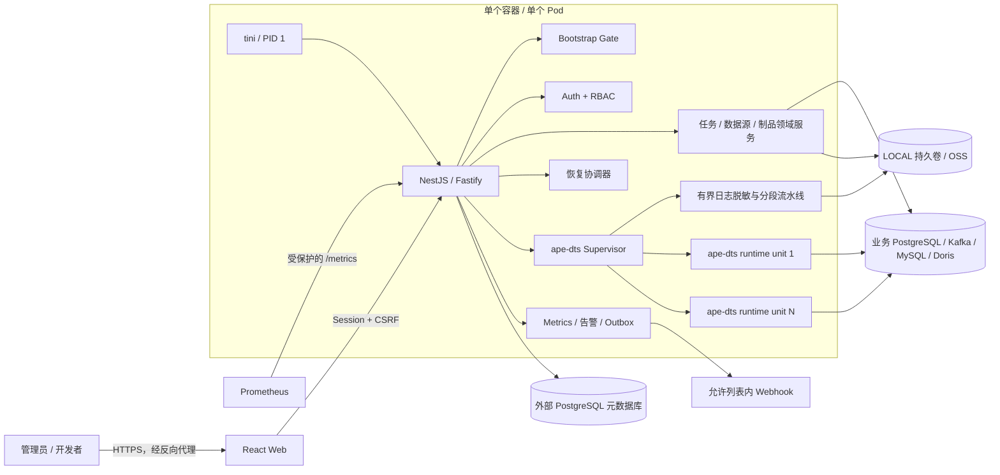
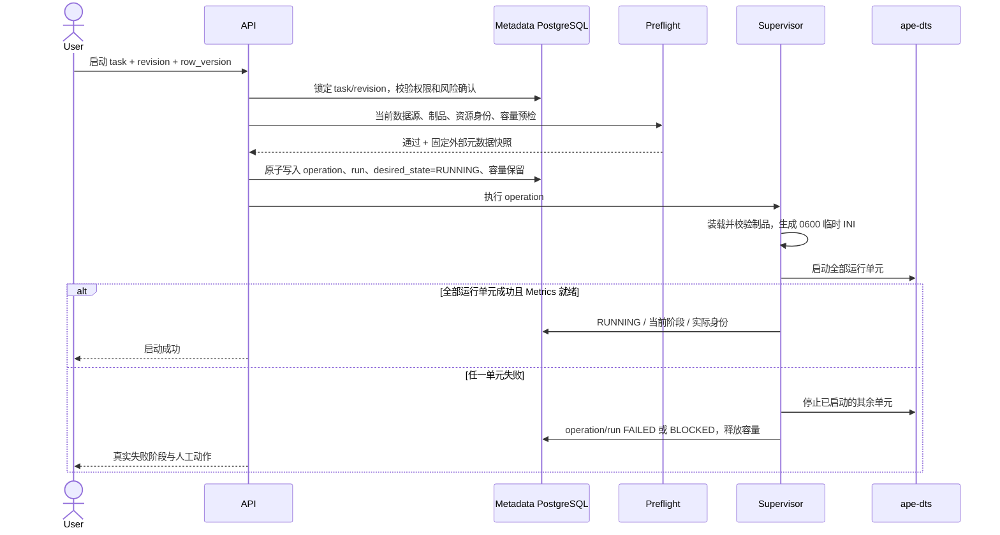
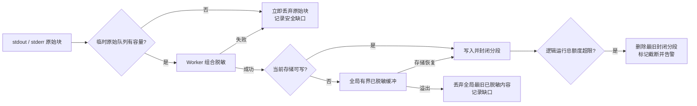

> 历史架构设计：包含首期约束和后续已调整的行为，当前支持范围以 README、路线图和操作文档为准。

# ape-dts 管理平台总体架构

> 状态：首期实施基线
> 日期：2026-09-07
> 运行模型更新：2026-10-12，单容器多子进程共享资源，以当前部署文档为准。
> 能力事实来源：`docs/technical/ape-dts-capability-matrix.md`

## 1. 架构目标

平台在不修改 ape-dts 的前提下，为用户提供单容器内的配置、进程、恢复、监控、通知、权限和审计能力。首期架构优先满足以下不变量：

1. 外部 PostgreSQL 是平台持久元数据的唯一事实来源，容器本地状态不能作为恢复兜底。
2. ape-dts 只以管理员认可并完成场景认证的二进制制品运行，不从源码构建。
3. 一个逻辑任务绑定不可变配置修订和明确制品版本；运行中编辑不改变当前进程。
4. 启动、重启、恢复和 Kafka 多 Partition 展开都必须按逻辑任务原子判定容量，不排队、不部分运行。
5. 外部资源身份或日志连续性无法证明时失败关闭，不自动换资源、接管资源或伪造连续性。
6. 元数据库故障时现有同步继续，管理面冻结；紧急入口只允许操作 Supervisor 内存中真实存在的子进程。
7. 所有自动恢复阶段均有等价的人工继续或重试入口，并且不能绕过人工恢复门。

## 2. 选定的系统形态

首期使用 pnpm workspace 管理 TypeScript 单仓：

- `apps/web`：React 桌面端管理界面。
- `apps/api`：NestJS + Fastify，提供 API、Bootstrap、认证授权、后台协调器和静态前端资源。
- `packages/contracts`：前后端共享的请求、响应和领域枚举校验模型。
- `packages/config-model`：任务类型化配置、制品能力约束和脱敏 INI 渲染模型。
- `packages/database`：PostgreSQL 查询、事务、迁移和分区维护。
- `packages/storage`：LOCAL 与 OSS 文件驱动及对象引用模型。
- `packages/observability`：Metrics 解析、聚合、告警计算、日志脱敏和 Prometheus 导出。

容器内只有一个平台 Node.js 主进程。该进程同时承载 HTTP 服务和后台协调器，并以 OS 子进程方式启动多个未经修改的 ape-dts 二进制。日志脱敏使用同进程内的有界 Worker Thread 池，避免高日志量长期占用 HTTP 事件循环；它不是独立服务，也不形成第二事实来源。



## 3. 进程与容器边界

### 3.1 PID 与信号

- `tini` 是 PID 1，平台 Node.js 进程是其直接子进程。
- 平台为每个运行单元建立独立进程组、Metrics loopback 端口、临时运行目录和内存身份记录。
- 容器收到 SIGTERM/SIGINT 后停止接受新的变更请求，先向每个已认证制品发送其记录的受控信号；当前基线为 SIGINT、等待、SIGTERM、再次等待、最后 SIGKILL。
- 只有实际经过受控信号路径并符合制品探针退出语义的退出才记录为优雅停止。
- 子进程不继承平台元数据库、OSS、Webhook 或其他任务的环境变量；本任务 Secret 只进入本任务的临时 INI。

### 3.2 共享容器资源与容量预算

- 单个平台容器承载多个逻辑 run；Runtime Supervisor 直接启动并管理各运行单元的 ape-dts 子进程，不创建任务容器或子 cgroup。
- Docker/Rancher 设置整个容器的 CPU、内存硬限额，覆盖平台 Node.js、日志、指标及全部任务进程；外部 PostgreSQL、Kafka 不计入容器额度。部署示例 4 CPU / 8 GiB 是容器总额，不是每 run 配额。
- `maxRuntimeUnits` 限制同时预留及活跃的运行单元总数；按逻辑任务原子预留，不排队、不超配、不部分启动。容量预算不限制单任务实际 CPU、内存消耗，安全并发数须经真实负载测试确定。
- 不要求宿主 cgroup v2、systemd 委派或可写宿主 cgroup，也不需要 privileged、Docker Socket 或编排 API 权限。任务启动仍校验权限、预检结果、制品完整性、指标端口及实际子进程启动结果。
- 只有确认运行单元已经退出后才释放容量；未确认退出保留句柄与容量并明确阻断。共享容器内单任务资源增长仍可能影响其他任务或触发容器 OOM。
- 平台不修改 Rancher 工作负载配额。部署和验证见 [Linux/Rancher 部署](../operations/docker-server-deployment.md)；预算与风险边界见 [容量包络](../operations/capacity-envelope.md)。

### 3.3 运行目录

| 路径 | 用途 | 持久性 |
| --- | --- | --- |
| `/run/ape-dts/<task_uuid>/<run_uuid>/<unit_uuid>/` | 单个运行单元的临时 INI 与临时文件 | tmpfs/容器生命周期；对应子进程退出即清理 |
| `/var/cache/ape-dts-platform/artifacts/` | 已验证制品的只读运行缓存 | 可重建；不能作为制品事实来源 |
| `/data/storage/` | LOCAL 文件驱动根目录 | 生产必须挂载持久卷 |
| 容器根文件系统 | 平台代码与静态资源 | 只读 |

运行缓存中的制品必须在每次装载和执行前核对 SHA-256；缓存缺失只触发从原存储引用重新装载，不能改变任务绑定版本。

### 3.4 单实例防重

Rancher 部署固定 `replicas=1`，更新策略使用 Recreate 或等价的零并发替换，不允许 surge。平台还使用专用 PostgreSQL 会话持有“运行控制器” advisory lock，防止正常网络条件下两个容器同时进入管理态。

数据库锁不能隔离网络分区中仍在运行的旧容器，因此上一实例非干净退出时，新容器恢复任务前还必须由部署管理员确认旧容器/进程已经停止，并执行以下辅助核对：

1. 检查上一平台实例的结束记录和心跳，非干净结束时进入恢复核对。
2. PG 任务确认绑定 Slot 没有旧 active PID。
3. Kafka 任务确认任务专属 Group 没有旧成员。
4. 明确记录上述检查只能提供风险证据，尤其不能把 Kafka Group membership 表述为通用的进程存活证明；任一证据不明确时阻塞该任务，不通过“锁已获取”或“Group 无成员”推断旧进程已经消失。

## 4. 平台内部模块

| 模块 | 责任 | 明确不负责 |
| --- | --- | --- |
| Bootstrap Gate | 初始化码、元数据库连接、Schema 判定、迁移确认、DEK 解锁、管理员恢复 | 保存数据库连接到本地；自动补表或自动迁移 |
| Identity & Access | 密码、TOTP、Session、CSRF、角色和数据源授权 | 仅靠前端隐藏菜单实现授权 |
| Secret Vault | 双 KEK 包装同一 DEK、应用 Secret 信封加密、恢复密钥重包裹 | 首期 DEK 全量轮换 |
| Data Source Catalog | CRUD、授权、连接测试、元数据发现、稳定身份采集 | 任意 SQL 控制台；自动使用历史成功结果 |
| Artifact Registry | 存储引用、哈希、格式探针、行为探针、场景认证、状态变更 | 互联网下载；根据声明版本猜能力 |
| Task Configuration | 服务端草稿、不可变修订、差异、风险确认、INI 预览和生成 | 持久化明文 INI；自动合并并发草稿 |
| Preflight Engine | 权限、身份、容量、Topic、Slot/Publication、制品能力和修订检查 | 修复不明确的外部状态 |
| PG Resource Manager | 固定模板创建任务专属 Slot/Publication、所有权和清理台账 | 任意 DDL；接管同名未知资源 |
| Runtime Supervisor | 运行单元展开、端口分配、子进程、信号、退出、固定自动恢复策略 | 业务配置决策；分布式调度 |
| Recovery Coordinator | 容器恢复的阶段、批次、进度、人工门和重试 | 绕过硬错误或人工恢复门 |
| Log Pipeline | drain stdout/stderr、脱敏、分段、额度、缺口和存储补写 | 原始日志入口；因日志故障重启同步任务 |
| Metrics Collector | ape-dts、PG Slot、Kafka Lag 的当前值和分层聚合 | 插值或补造观测缺口；将共享容器数据冒充单任务资源 |
| Alert & Notification | 告警 episode、ACK、站内通知、Webhook Outbox | 将 ACK 当作恢复；用资源告警自动停任务 |
| Audit Ledger | 追加式审计、完整性链、元数据库故障缺口 | 宣称数据库管理员不可篡改 |

## 5. 持久化与事实所有权

### 5.1 外部 PostgreSQL

PostgreSQL 保存用户、Session、授权、Secret 密文、任务与修订、运行意图、运行记录、外部资源身份、制品元数据、文件索引、指标、告警、Outbox 和审计。平台采用显式 SQL 迁移文件、迁移 checksum、独占 advisory lock 和单事务升级；Schema 版本只有在全部 DDL 成功后才更新。

平台不把以下内容写入 PostgreSQL：

- 明文元数据库口令、解锁口令或离线恢复密钥；
- 明文数据源/OSS/Webhook/TOTP Secret；
- 含 Secret 的运行时 INI；
- ape-dts stdout/stderr 正文；
- Kafka 消息 payload、key 或 headers。

### 5.2 文件存储

文件对象不只记录 object key，还必须绑定不可变 `storage_profile_id`。平台允许一个可写存储配置和多个仍被历史对象引用的只读配置版本：

- 激活新的 LOCAL/OSS 配置只影响后续写入，不隐式搬迁历史对象。
- 历史制品和日志继续通过其原 `storage_profile_id` 读取。
- 有对象引用的存储配置不能删除或销毁 Secret；只能停用新写入。
- 首期不自动跨驱动迁移对象。部署方外部迁移后，需要管理员执行清单核对和逐对象引用切换；未通过校验时原引用保持不变。

这避免“切换当前存储配置”把历史文件错误展示为空文件或成功状态。

### 5.3 内存状态

只有以下状态允许仅存在内存：当前进程初始化码/紧急停止码校验值、已解锁 DEK、实际子进程句柄、临时原始日志块和有界的已脱敏日志/故障审计待补队列。容器退出后这些内容允许丢失；平台必须按需求记录或展示相应缺口，不能据此恢复业务事实。

## 6. 关键调用路径

### 6.1 正常启动任务



任何启动请求都携带客户端 idempotency key 和任务 `row_version`。相同 key 只返回原操作；不同请求在同一任务行锁下串行判定。事务提交前不能启动进程，事务提交后即使 HTTP 连接中断，操作仍可从持久阶段继续。

### 6.2 容器恢复

恢复顺序固定为：Bootstrap 与 Schema → 密钥解锁 → 元数据装载 → 制品就绪 → 外部资源与旧进程核对 → 全部候选容量核算 → 任务批次恢复 → 监控就绪。每一步持久化开始、成功、失败和可重试条件；已成功的幂等步骤不会因后续失败被破坏性重做。

候选总运行单元超限时，恢复协调器不启动任何候选任务。管理员提高上限或显式选择满足上限的任务集合后，才建立本轮恢复计划；未选任务持久标记为容量阻塞，后续出现空闲容量也不会自行进入队列。

### 6.3 日志处理



Supervisor 必须持续 drain 子进程管道。原始日志等待脱敏的队列也有固定内存上限；队列满或 Worker 异常时按 R14h 失败关闭对应块，不能通过对子进程施加无限背压而影响同步吞吐。原始块不进入容器日志、数据库或磁盘。

## 7. 一致性、锁与并发

- 单任务变更：事务内 `SELECT ... FOR UPDATE` 锁定未删除任务，并同时校验 `row_version`。
- 草稿保存：以 `revision_number`/`row_version` 比较并拒绝陈旧写入，不提供强制覆盖。
- 启停操作：一个任务同一时间只允许一个非终态 `task_operation`，数据库部分唯一索引保证。
- 运行单元容量：在同一事务内锁定单行平台容量配置，统计有效 reservation 后整体保留或整体拒绝。
- 外部资源名称：以数据源稳定身份、数据库、资源类型和规范化名称建立活动唯一约束；不能只按显示名称判断。
- Kafka 任务：同一元数据快照固定 `cluster.id + topic_id + partition_set`，一次操作创建全部运行单元。
- Outbox：记录与业务事件同事务写入；投递器使用 `FOR UPDATE SKIP LOCKED` 领取，`event_id` 稳定、`delivery_id` 每次尝试变化。
- 定时清理：即使首期单实例，也使用数据库 lease/advisory lock 防止进程内重复调度和未来误启动两个实例时重复清理。

## 8. 降级与故障语义

| 故障 | 同步进程 | 管理面 | 恢复原则 |
| --- | --- | --- | --- |
| 元数据库不可用 | 已运行任务继续 | 变更冻结；仅紧急停止页可用 | DB 恢复后对账并补写可证明的审计/告警，缺失区间显式标记 |
| 文件存储不可写 | 继续 | 日志查看标记降级 | 仅缓冲已脱敏内容，原驱动重试，不切换驱动 |
| Metrics 不可用 | 继续并标记 `RUNNING_DEGRADED` | 展示真实采集错误 | 重试采集；不能触发任务重启 |
| 制品 `INACTIVE` | 当前进程继续 | 禁止所有新启动路径 | 改选其他 ACTIVE 制品或重新启用并预检 |
| 制品 `QUARANTINED` | 受控停止 | 全部恢复阻塞 | 重新装载并完整认证，不能直接改状态 |
| PG Slot 身份/LSN 不连续 | 停止或不启动 | 永久阻塞旧任务 | 删除旧任务并创建新任务 |
| Kafka Source Topic ID 变化 | 停止或不启动 | 永久阻塞旧任务 | 删除旧任务并创建新任务 |
| Kafka 新增 Partition | 停止整个逻辑任务 | 人工恢复门 | 用户确认新增 Partition 从 latest 开始后启动完整集合 |
| 单运行单元失败 | 停止同逻辑任务其余单元 | 任务 FAILED/BLOCKED | 固定自动恢复额度或人工恢复，不允许部分运行 |

## 9. 安全与信任边界

### 9.1 边界

1. 浏览器到平台：当前按受控公司内网 HTTP 部署，Session Cookie 使用 HttpOnly、SameSite=Strict 和受限 Path，变更请求验证 CSRF。HTTP 不提供传输加密，须通过防火墙和网络策略限制访问，禁止直接暴露公网；HTTPS 支持后续按部署需求实现。
2. 平台到元数据库和数据源：除已明确接受的 Kafka PLAINTEXT 差距外，生产默认使用 TLS 并验证证书与主机名；私有化环境需要明文内网连接时必须由管理员显式启用、持续提示风险并审计。
3. 平台到文件存储：OSS 凭据由 Secret Vault 解密到最短调用周期；LOCAL 路径必须规范化并拒绝符号链接逃逸。
4. 平台到 Webhook：保存、测试、投递和每次 DNS 解析后都重新执行允许列表校验，不跟随重定向；公网目标只允许 HTTPS。
5. 平台到 ape-dts：二进制被视为与后端同等可信的原生代码。非 root、capability 清理和 no-new-privileges 只能缩小意外损害面，不能隔离恶意制品。

### 9.2 Secret 生命周期

- 解锁口令使用带独立随机盐和参数版本的 Argon2id 派生 KEK；最低参数在目标容器资源下基准确定，不能回退到快速哈希。
- 解锁口令只用于内存中派生 KEK，不持久化。
- 业务 Secret 使用随机 nonce 的认证加密，AAD 绑定 owner type、owner id、purpose 和 schema version，防止密文跨字段替换。
- DEK 只在平台 READY 期间驻留内存；Bootstrap 未完成或锁定态不能调用需要 Secret 的 API。
- 明文 INI 以 `O_CREAT|O_EXCL` 和 `0600` 创建；退出、启动失败和平台关停都执行清理，启动恢复时也清扫上个容器不可能仍合法持有的运行目录。
- 容器关闭 core dump，诊断包和异常对象不得包含 INI、Secret 或原始日志块。

### 9.3 认证会话

- 登录、TOTP 和恢复码按“账号 + 来源”组合限速并采用有上限退避；失败事件进入审计和安全告警。
- 登录成功后创建新的 Session ID；Session 同时具有空闲超时和绝对超时。管理操作沿用有效会话、权限与 CSRF 校验，不再额外要求密码再认证；会话过期后重新登录。
- Session Cookie 按当前内网 HTTP 部署策略不设置 Secure，保留 HttpOnly、SameSite=Strict 和受限 Path；登录、改密及退出使用一致策略，不通过请求头自动切换模式。当前未提供 HTTPS 配置项。
- 同一个 TOTP 时间窗内的验证码对同一账号只能成功使用一次；恢复码使用后在同一事务中失效。

### 9.4 日志内容保护

- 任务日志按可能包含敏感业务数据管理。LOCAL 生产卷和备份必须加密，OSS 必须使用私有 ACL、最小前缀权限和服务端加密；平台首期不把基础设施加密误述为未知内容已被脱敏。
- 每个封闭日志分段在 PostgreSQL 保存 SHA-256、字节数和存储版本；查看和下载前验证，失败显示“完整性异常”且不返回未经确认的内容。
- 页面只以经过上下文编码的纯文本展示日志，不渲染 HTML/Markdown；下载使用安全生成文件名、`Content-Disposition: attachment`、`text/plain` 和 `nosniff`，Web UI 使用严格 CSP。
- 日志摄取同时受每块大小、每运行单元字节率和平台全局有界原始队列约束；超限丢弃相应块、记录永久缺口并告警，不能拖死 HTTP、Supervisor 或紧急停止入口。准确预算由真实制品压力基准确定后固化。

### 9.5 审计完整性

审计事件采用仅追加写入、单调序号和 `previous_hash + canonical_event -> event_hash` 完整性链。它能发现应用层历史被修改，不能防御拥有元数据库超级权限的操作者重写整条链，因此界面和文档不得宣称“绝对不可篡改”。元数据库故障期间的紧急动作先进入容器结构化日志和有界内存待补队列；丢失时记录审计缺口，而不是补造事件。

## 10. 可观测性架构

- ape-dts Metrics 每 15 秒采集，PG Slot 每 30 秒，Kafka 元数据/Offset 每 60 秒。
- 原始/Partition 明细、1 分钟和 1 小时聚合使用独立 PostgreSQL 原生时间分区与各自保留任务。
- 当前状态与有限维度聚合通过平台 `/metrics` 暴露；不导出 task name、error text、topic、slot 等无界或敏感标签。
- 容器总体资源通过 Docker/Rancher 部署侧监控核验，不能冒充单任务资源数据；任务指标仍来自各运行单元自身的 Metrics，不依赖可写 cgroup。
- PG Slot 查询必须带当前任务绑定的精确 `slot_name` 和目标数据库身份条件；不以无权限错误返回空列表。
- 任何指标写入失败形成观测缺口；同步状态与监控状态分开计算。

## 11. Docker 与 Rancher 基线

- 多阶段构建：前端构建、后端构建、Debian slim 运行镜像。
- 镜像包含 `tini` 和运行 ape-dts 所需、经探针确认的最小动态库，不包含 Rust 工具链或 ape-dts 源码。
- 以固定非 root UID/GID 运行；root filesystem 只读，显式挂载 `/run/ape-dts` tmpfs、运行缓存和 `/data/storage` 持久卷。
- 部署层设置容器/Pod 总体 CPU、内存限额，无需配置 cgroup v2 委派、宿主层级或进程迁移权限。
- entrypoint 不创建或重排宿主 cgroup，不迁移平台进程或未知进程；运行缓存、持久化存储及临时运行目录须允许 UID `10001` 写入。
- 不使用 privileged 容器、Docker Socket 或 host cgroup 挂载。旧 `SCS_RUNTIME_CGROUP_ROOT`、`SCS_RUNTIME_RUN_CPU_MAX`、`SCS_RUNTIME_RUN_MEMORY_MAX_BYTES` 已不再使用，升级迁移见 [旧方案说明](../operations/cgroup-v2-delegation.md)。
- 默认不把子进程 Metrics 端口、调试端口或元数据库暴露到 Service。
- liveness 只证明平台进程/event loop 存活；readiness 只有 Bootstrap 完成且平台可安全服务时成功，元数据库故障时返回未就绪但不主动杀死 Pod。
- `terminationGracePeriodSeconds` 必须大于 Supervisor 两段优雅等待与平台收尾时间之和。
- 容器/Pod 的资源 limit 是生产必配项，由部署侧配置与监控；平台只管理运行单元容量预算，不自行改 Rancher 配额，不设置每 run 的操作系统硬限额。

## 12. 推荐的代码边界

```text
apps/
  api/src/
    bootstrap/ auth/ users/ data-sources/ artifacts/
    tasks/ runtime/ recovery/ storage/ observability/
    notifications/ audit/ database/ health/
  web/src/
    app/ pages/ features/ components/ api/ auth/
packages/
  contracts/
  config-model/
  database/
  storage/
  observability/
docker/
  entrypoint/
docs/
  architecture/ operations/ security/ plans/
```

领域模块只能通过明确端口调用 runtime、storage、database 和 notification 模块，不能在控制器中直接 spawn 进程、拼 SQL/INI 或读取 Secret。

## 13. 已否决或暂缓的替代方案

| 方案 | 结论 | 原因 |
| --- | --- | --- |
| 修改 ape-dts 源码提供管理 API | 否决 | 违反产品硬约束，升级耦合 |
| 每任务独立容器/Pod | 首期暂缓 | 与单 Pod 约束不符；未来接纳不可信制品时必须重审 |
| Redis/BullMQ 或独立消息队列 | 否决 | 单实例不需要第二持久事实来源，PostgreSQL operation/outbox 足够 |
| Grafana 直连元数据库 | 否决 | 放大数据和权限边界，统一由 Prometheus `/metrics` 暴露 |
| 自动切换 LOCAL/OSS | 否决 | 容易造成双写、缺口和错误成功状态 |
| 用 Prometheus 作为首期唯一监控存储 | 否决 | 当前环境未就绪，平台必须可独立运行 |
| 把全部高频 Metrics 永久保存在 PostgreSQL | 否决 | 使用分层保留和聚合控制写放大与容量 |

## 14. 实施前验证门

以下工作先于完整业务功能开发：

1. 制品探针 PoC：固定启动参数、INI 字段、退出码、信号、Metrics/Health 和日志泄露场景。
2. PG Snapshot → CDC 对账：使用源端单调事件账本、目标逐事件对账和故障注入矩阵；任何不可解释缺失即失败。
3. Kafka Raw 对账：覆盖全部 Partition、null/non-null key、payload、headers、ACK、Group Offset 和进程故障重复窗口。
4. 身份探针：验证目标 Kafka 客户端可稳定读取 cluster ID/topic ID，目标 PostgreSQL 账号可读取 system identifier 和所需 Slot 字段。
5. 容量基准：分别度量 Pod/子进程、平台元数据库写入与保留、源 PG Slot/WAL；在基准前不声明固定任务数或 TPS。

验证失败时保持对应任务类型或制品能力不可发布，并回到需求评审；实现不得通过默认值、自动重试或隐藏错误改变业务语义。
