> 历史架构设计：包含首期约束和后续已调整的行为，当前支持范围以 README、路线图和操作文档为准。

# ape-dts 管理平台状态机

> 状态：首期实施基线
> 日期：2026-09-01
> 来源：`docs/brainstorms/2026-09-01-ape-dts-management-platform-requirements.md`

## 1. 建模约定

任务状态必须拆成多个正交事实，禁止用一个大枚举同时表达用户意图、进程事实、阶段和监控健康：

| 维度 | 取值 | 事实来源 |
| --- | --- | --- |
| `desired_state` | `STOPPED | RUNNING | DELETED` | 用户动作和恢复意图，持久化 |
| `observed_state` | `STOPPED | STARTING | RUNNING | STOPPING | FAILED | BLOCKED | DELETED` | Supervisor/协调器核对后的进程事实 |
| `current_stage` | 预检、制品、资源、INI、Snapshot、CDC、Kafka Forward、监控等 | 当前 operation/run stage |
| `observability_health` | `HEALTHY | DEGRADED | UNAVAILABLE` | Metrics、日志和外部状态采集 |
| `recovery_disposition` | `AUTO_ELIGIBLE | MANUAL_REQUIRED | CAPACITY_BLOCKED | PERMANENTLY_BLOCKED | NOT_APPLICABLE` | 恢复规则 |

UI 的 `RUNNING_DEGRADED` 是 `observed_state=RUNNING` 且 `observability_health!=HEALTHY` 的派生标签，不写成第三种运行事实。元数据库不可用期间，普通 UI 不从旧数据库记录推断状态；紧急页只展示 Supervisor 内存中的实际进程。

所有状态变更记录 `from`、`to`、原因码、操作者/系统主体、时间、关联 operation/run、乐观锁版本。禁止直接 UPDATE 状态而不写阶段和审计事件。

## 2. 平台 Bootstrap 与运行态

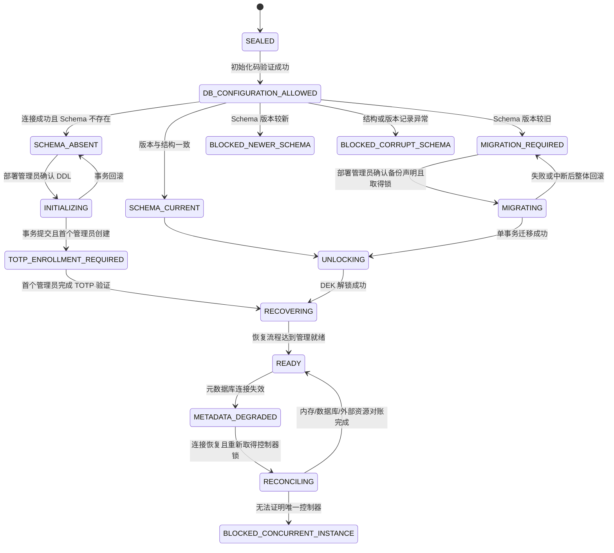

### 2.1 身份边界

- “部署管理员”是持有当前容器初始化码并能提供元数据库连接/解锁材料的操作者，不等同于登录后的平台管理员角色。
- 新 Schema 初始化、旧 Schema 迁移、唯一管理员恢复和解锁口令恢复都发生在登录前，由部署管理员确认并单独审计。
- 平台管理员只能在 READY 后执行用户、数据源、存储、制品和任务管理；职责表中的“迁移确认”统一指部署管理员，而不是登录 Session。

### 2.2 特殊恢复分支

| 分支 | 前置 | 允许动作 | 成功后 |
| --- | --- | --- | --- |
| 唯一管理员恢复 | 初始化码 + 正确 DB + 正确解锁口令 + 已有 Schema | 只重置既有唯一管理员密码/TOTP | 撤销其全部 Session，告警并回到登录 |
| 解锁口令恢复 | 初始化码 + 正确 DB + 离线恢复密钥 | 重包装同一 DEK 并设置新口令 | 原 Secret 密文不变，旧口令失效 |
| 迁移重试 | 旧 Schema + 迁移锁可用 + 备份声明 | 重跑全部待执行事务迁移 | 成功进入解锁；失败仍阻塞 |

初始化码任一成功用途后立即失效。紧急停止码只有 Bootstrap 成功后生成，不能用于上述流程。

## 3. 配置草稿与修订

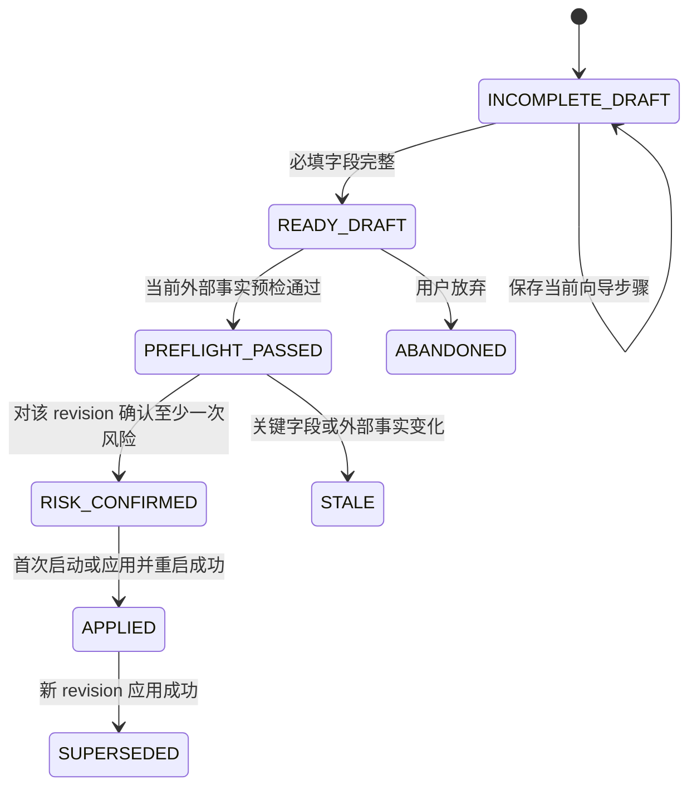

- 一个任务最多有一个未放弃草稿和一个当前已应用修订。
- 草稿内容每次成功保存都生成递增 `draft_version`；陈旧版本保存失败且不修改服务器内容。
- Source、Target、任务类型、消息 key、制品或快照策略变化会清除预检与该修订风险确认。
- 切换任务类型或数据源先产生“待清除字段预览”；确认后一次事务清除，取消时逐字段不变。
- 复制任务产生新 UUID、新草稿、新 Kafka Group/PG 资源命名空间；不复制修订确认、运行状态和资源所有权。

## 4. 任务操作状态机

任务创建后即使草稿未完成，任务列表的生命周期仍显示 `STOPPED` 并附加“未完成”标签；未完成草稿不能进入预检。

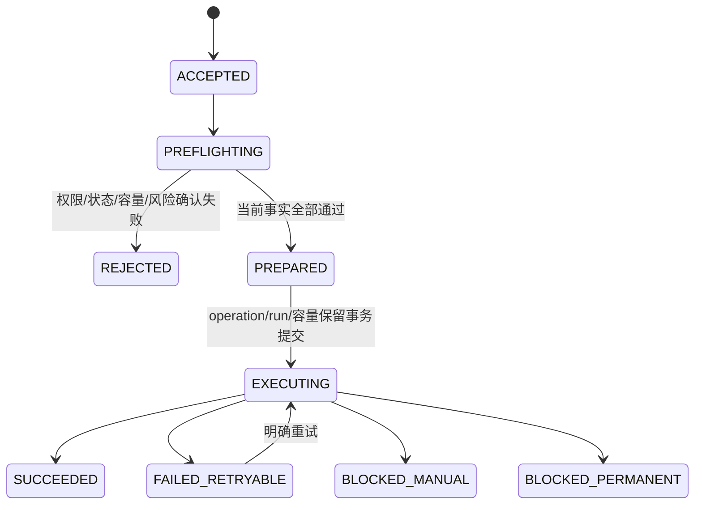

首期不设置后台排队态。容量不足在 `PREFLIGHTING` 整次拒绝；容器恢复容量超限则建立显式恢复计划并标记 `CAPACITY_BLOCKED`，也不形成自动队列。

同一任务同一时间只有一个非终态 operation。请求必须同时提供：

- 用户权限、登录会话有效性与 CSRF 校验结果；
- task `row_version`；
- 目标 revision；
- 客户端 idempotency key；
- 动作所需的二次确认/原因。

## 5. 正常任务生命周期

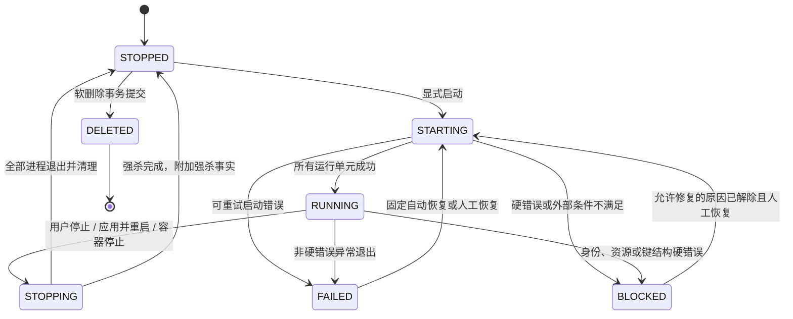

### 5.1 FAILED 与 BLOCKED

| 分类 | 示例 | 自动恢复 | 用户可执行 |
| --- | --- | --- | --- |
| `FAILED_RETRYABLE` | 临时网络错误、未归类的首次非零退出 | 受 R32 一次额度约束 | 查看、停止意图、人工重试 |
| `BLOCKED_MANUAL` | Topic 暂时缺失、Publication 缺失、容量恢复未选中 | 否 | 外部修复后重新预检/恢复 |
| `BLOCKED_PERMANENT` | PG 身份/Slot/LSN 不连续、Kafka cluster/topic ID 变化 | 否 | 停止并删除，复制配置创建新任务 |
| `BLOCKED_POLICY` | 制品 INACTIVE/QUARANTINED、开发者试图使用 APE_DTS_MANAGED | 否 | 更换/重新认证制品或由允许角色修正 |

任何硬错误都不能因为等待时间、容器重建或增加重启次数重新变为自动恢复资格。

### 5.2 停止

1. 在数据库可用时先原子写入 `desired_state=STOPPED` 和 STOP operation。
2. 对每个进程发送制品认证的受控信号，当前基线为 SIGINT。
3. 第一窗口超时后 SIGTERM，第二窗口超时后 SIGKILL。
4. 等待全部运行单元终态，关闭日志分段、删除各单元 INI、释放端口和容量。
5. 任何强杀单独记录操作者原因和审计。

元数据库故障时，紧急入口不改变不可访问的数据库事实；它只停止内存中的实际进程并进入待补记录。

## 6. PG Source 阶段机

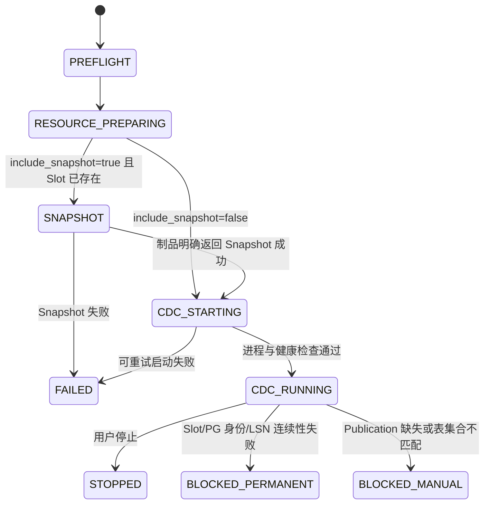

### 6.1 资源创建约束

- `SELF_MANAGED`：只验证，不创建、不修改、不删除。
- `PLATFORM_MANAGED`：只有 `data_stage_started_at IS NULL` 才能幂等创建；同名但所有权不匹配立即阻塞。
- `APE_DTS_MANAGED`：仅管理员、纯增量、`recreate_slot_if_exists=false`；运行后缺 Slot 永不再次自动创建。
- Slot/Publication 创建成功而后续失败时保留资源并进入人工恢复，不做补偿删除。
- 进入 Snapshot 或首次 CDC 前冻结 `system_identifier + database_identity + slot_name + plugin`，随后单调更新已观测 `confirmed_flush_lsn`。

Snapshot 总量未知时阶段仍为 `SNAPSHOT`，进度模型为不定进度；只有认证制品返回可靠总量时才计算百分比和 ETA。

## 7. Kafka → Kafka 逻辑任务

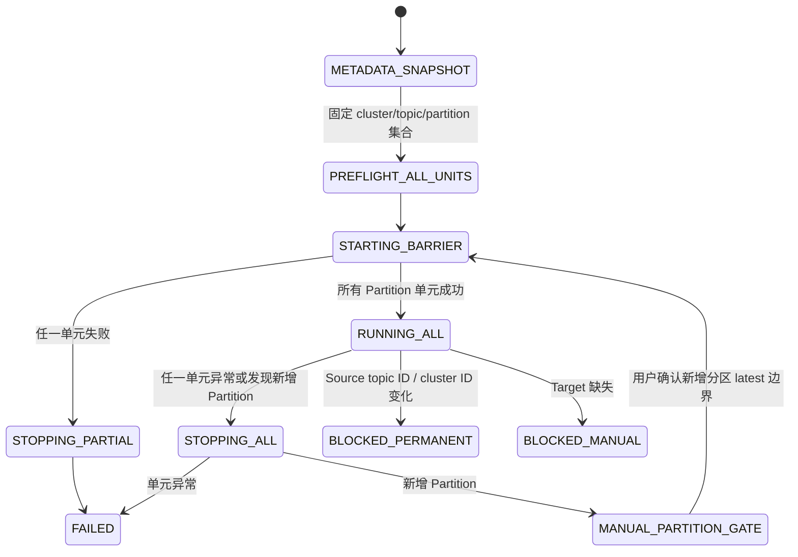

- 一个逻辑 run 包含启动时全部 Source Partition 的 unit；每个 unit 有独立目录、INI、子进程、Metrics 端口和日志流。
- 所有 unit 共用任务唯一 Group ID，但各自固定 Partition；是否能由 Kafka Group membership 证明进程存活必须按实际制品认证。平台外旧进程迁移场景由部署管理员确认旧部署已停止，Group/Slot 状态只作辅助风险检查。
- 只有全部 unit 到达运行屏障，`observed_state` 才为 RUNNING。
- 运行中一个 unit 失败，先停止其他 unit，再按错误分类进入 FAILED/BLOCKED。
- 新增 Partition 不动态补进程；停止全任务并要求用户确认。原 Partition 使用已提交 Offset，新 Partition 从确认后的 latest 开始。
- Source topic ID 变化永久阻塞；同 cluster 的 Target 同名重建可重新预检并人工恢复。

## 8. 固定自动恢复额度

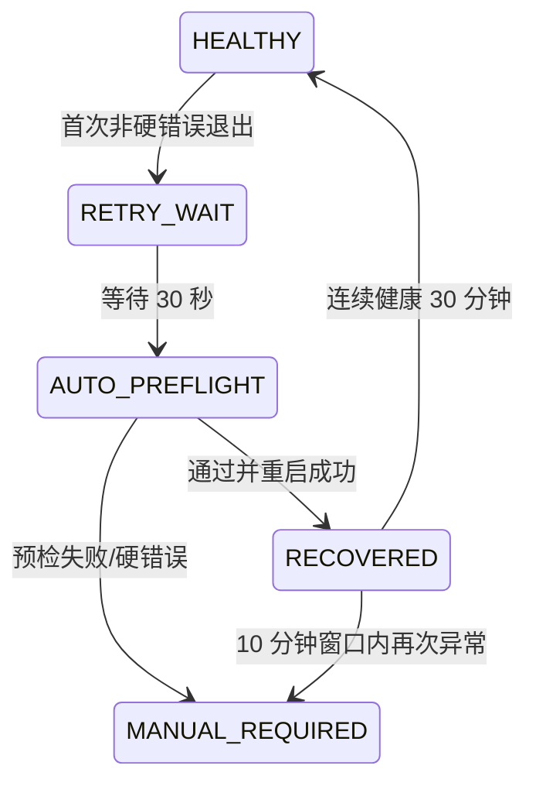

- 30 秒等待和自动预检期间保留该逻辑任务原有容量 reservation，避免其他任务抢占后产生部分恢复；进入人工门或停止后释放。
- 第一次退出、自动恢复尝试产生警告；第二次进入人工门产生高优先级告警。
- 用户停止、配置错误、身份变化、资源缺失、键漂移、制品隔离、容量错误和 Metrics 降级不消耗也不触发自动恢复额度。
- 人工恢复成功后重新获得一次额度，但健康重置仍按之后连续运行 30 分钟计算。

## 9. 容器恢复流水线

| 阶段 | 状态 | 自动成功条件 | 失败/人工动作 |
| --- | --- | --- | --- |
| 元数据库 | `LOAD_METADATA` | Schema 当前、控制器锁取得 | 重新连接、迁移或阻塞并发实例 |
| 密钥 | `UNLOCK_KEYS` | 正确口令解锁同一 DEK | 重试或离线恢复密钥重包裹 |
| 制品 | `ENSURE_ARTIFACTS` | 绑定制品 ACTIVE 且缓存哈希一致 | 重新装载/认证或改选制品 |
| 旧进程/资源 | `VERIFY_CONTINUITY` | 身份、资源、成员/active 状态满足 | 外部修复、确认旧部署停止或永久阻塞 |
| 容量计划 | `PLAN_CAPACITY` | 全部候选总量不超上限 | 提高上限或显式选择任务集合 |
| 任务批次 | `RESTORE_BATCHES` | 仅自动资格任务分批成功 | 单任务重试/跳过/人工恢复 |
| 监控 | `READY_OBSERVABILITY` | 采集器建立 | 任务继续但派生 RUNNING_DEGRADED |

每个阶段实例具有 `PENDING | RUNNING | SUCCEEDED | FAILED | PAUSED`。手动“重试”只能从该失败阶段重做幂等动作；手动“继续”只能用于文档明确允许的人工门，不能把错误改成成功。

## 10. 制品状态机

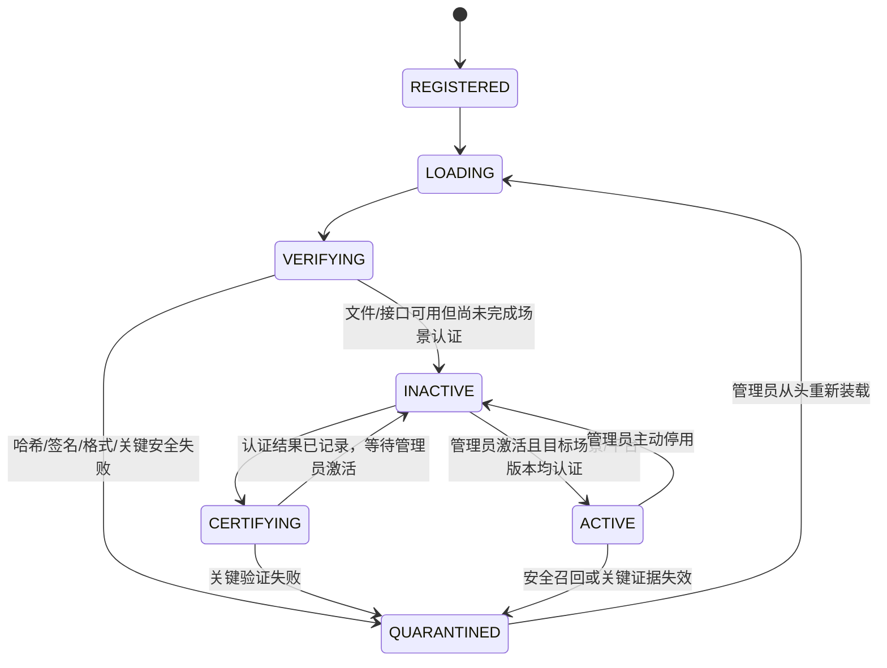

- `INACTIVE` 不停止当前进程，但阻止启动、重启、应用和自动恢复。
- `QUARANTINED` 立即触发所有关联任务受控停止。
- 解除隔离不能直接 UPDATE 为 ACTIVE；必须重新装载并完成当前部署已启用的签名校验、行为、场景和平台兼容认证。
- 制品必须使用受控 console-only 日志配置；任何会绕过平台管道直接写原始文件或无法提供所需 stdout/stderr 的制品不能通过首期场景认证。

## 11. 日志分段、缺口与存储

### 11.1 分段

`OPEN -> SEALED -> AVAILABLE` 是正常路径。只有 SEALED 分段可因逻辑运行容量滚动删除；当前 OPEN 分段先封闭后再参与后续判断。

每个逻辑 run 在首次日志落库前绑定一个 storage profile，全部 unit、stdout/stderr 和存储故障后的补写都沿用该绑定。新的 `ACTIVE_WRITE` 只影响尚未绑定的运行；已绑定 profile 转为 `READ_ONLY_REFERENCED` 后仍允许原运行继续写入。数据库拒绝 segment 对象 profile 与 run 绑定不一致，也拒绝活动 run 绑定已退役 profile。

删除/异常结果使用事实字段而不是覆盖状态：

- `deleted_reason=RETENTION | CAPACITY_ROLLOVER`
- `unavailable_reason=STORAGE_MISSING | INTEGRITY_MISMATCH`
- `gap_reason=REDACTION_FAILURE | RAW_QUEUE_OVERFLOW | STORAGE_BUFFER_OVERFLOW | CONTAINER_RESTART | STREAM_ERROR`

每个 `STREAM_ERROR` 事件按 run + unit 独立记录，不区分 stdout/stderr；丢失字节和时间边界保持 unknown，事件时间保存在 `occurred_at`。

运行记录永久派生 `truncated=true` 或 `has_gap=true`，直到运行记录本身按 365 天规则清理。

### 11.2 存储故障

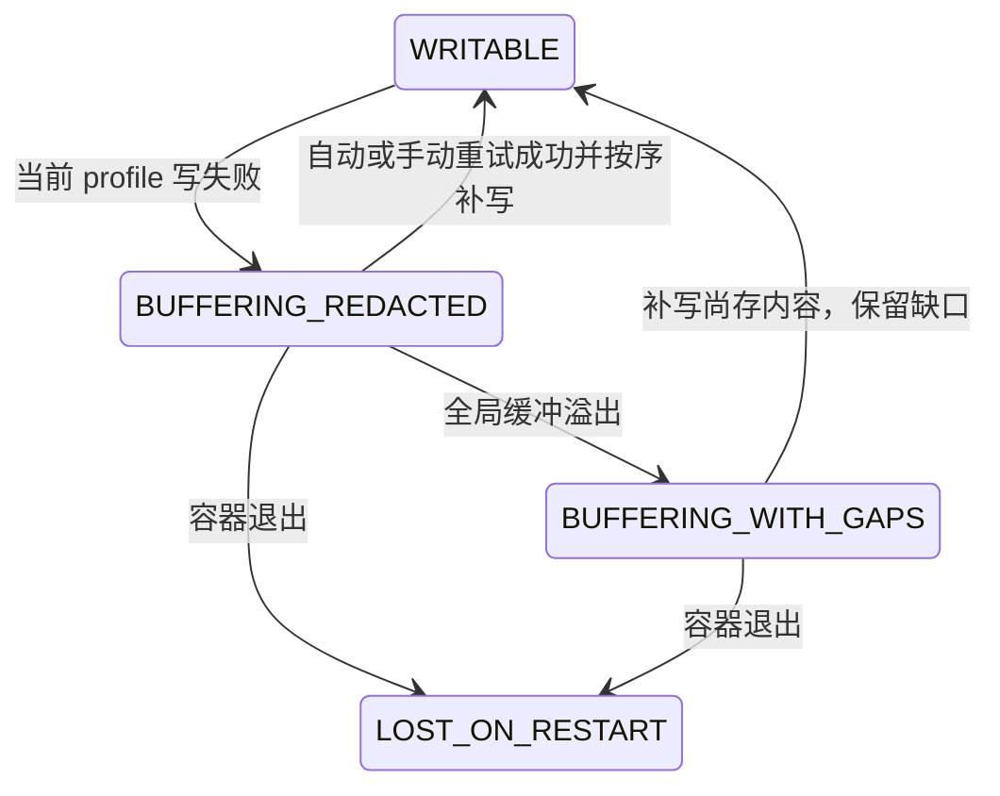

不得切换 storage profile 自动补写。降低全局缓冲额度时，预览并二次确认后按全局进入顺序丢弃最旧已脱敏内容。

容器启动并确认元数据库已处于当前版本后，恢复器处理已持久化中间态：

- `PENDING object + SEALED segment` 且文件大小、SHA-256 均匹配时收敛为 `AVAILABLE`；
- 文件不存在时转为 `MISSING/STORAGE_MISSING`，文件不匹配时转为 `INTEGRITY_FAILED/INTEGRITY_MISMATCH`；两者都记录 `CONTAINER_RESTART` gap 并设置 run 的 `has_gap=true`，但不改变同步进程事实；
- 删除先写 `log_segment_deletion_requests`，再删文件并原子完成对象、分段和请求状态；启动时重试未完成请求。

LOCAL writer 在写入、读取既有对象和删除前拒绝 root 或任一父目录符号链接，并使用不可覆盖发布。该检查降低误配置和常规路径替换风险，但 Node 路径 API 无法消除恶意同 UID 进程在检查后替换目录的 TOCTOU；生产存储目录必须只授予平台存储进程写权限。

## 12. 外部资源与删除清理

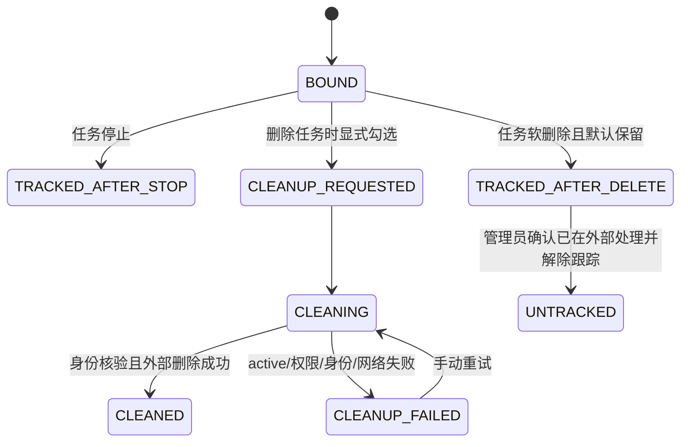

- 任务软删除事务先提交，异步清理不能把任务恢复为未删除。
- `SELF_MANAGED` 不存在 CLEANUP_REQUESTED 转移。
- Slot/Publication 之外的 Topic、Offset、历史业务数据永远不进入该状态机。
- 停止或删除后仍跟踪的 Slot 继续采集 WAL 风险，直到验证 CLEANED 或管理员显式 UNTRACKED。

## 13. 告警与通知

告警异常事实只有：

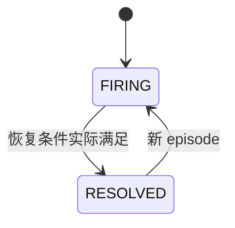

`acknowledged_at/by/note` 是 FIRING episode 的独立字段。UI 可把“FIRING 且已确认”派生展示为 `ACKNOWLEDGED`，但 ACK 不改变异常事实、任务状态、恢复行为或下一 episode。

Webhook Outbox：

`PENDING -> DELIVERING -> DELIVERED`；失败进入 `RETRY_WAIT`，按有限退避回到 DELIVERING，超过策略进入 `FAILED` 并保留人工重试。重试保持 event_id，不复用 delivery_id。

## 14. 数据源、存储配置与删除

### 14.1 数据源

`ACTIVE -> DELETION_CHECK -> SOFT_DELETED`。DELETION_CHECK 只有同时满足以下 WHERE 语义才通过：

1. 不存在 `deleted_at IS NULL` 的任何任务引用；
2. 不存在依赖该连接验证/重试的未终态外部资源台账；
3. 请求者是管理员且 row_version 匹配。

软删除和 Secret 密文销毁在同一事务完成。失败时二者都不改变。

### 14.2 存储配置

`DRAFT -> ACTIVE_WRITE`；激活新 profile 后旧 profile 变为 `READ_ONLY_REFERENCED`。只有非删除对象引用计数为零且没有 `STARTING|RUNNING|STOPPING` run 绑定时，才可 `RETIRED` 并销毁 Secret。首期不自动迁移文件，也不因当前 profile 变化改写历史对象引用。

## 15. 允许操作矩阵

| observed state | 编辑草稿 | 启动 | 停止 | 应用并重启 | 删除 | 复制 |
| --- | --- | --- | --- | --- | --- | --- |
| STOPPED | 是 | 完整草稿+预检+确认后 | 否 | 否 | 无进程时是 | 是 |
| STARTING | 只保存草稿 | 否 | 是 | 否 | 否 | 是 |
| RUNNING | 只保存草稿 | 否 | 是 | 草稿完整且重新确认后 | 否 | 是 |
| STOPPING | 只读/等待 | 否 | 否 | 否 | 否 | 是 |
| FAILED | 是 | 人工恢复路径 | 否 | 是 | 无进程时是 | 是 |
| BLOCKED_MANUAL | 是 | 修复后人工恢复 | 否 | 是 | 无进程时是 | 是 |
| BLOCKED_PERMANENT | 否 | 否 | 否 | 否 | 无进程时是 | 复制配置创建新任务 |
| DELETED | 否 | 否 | 否 | 否 | 否 | 复制为新任务 |

所有按钮同时受服务端角色、任务管理权限、数据源授权、元数据库可用性和乐观锁校验；页面显示不构成授权。
